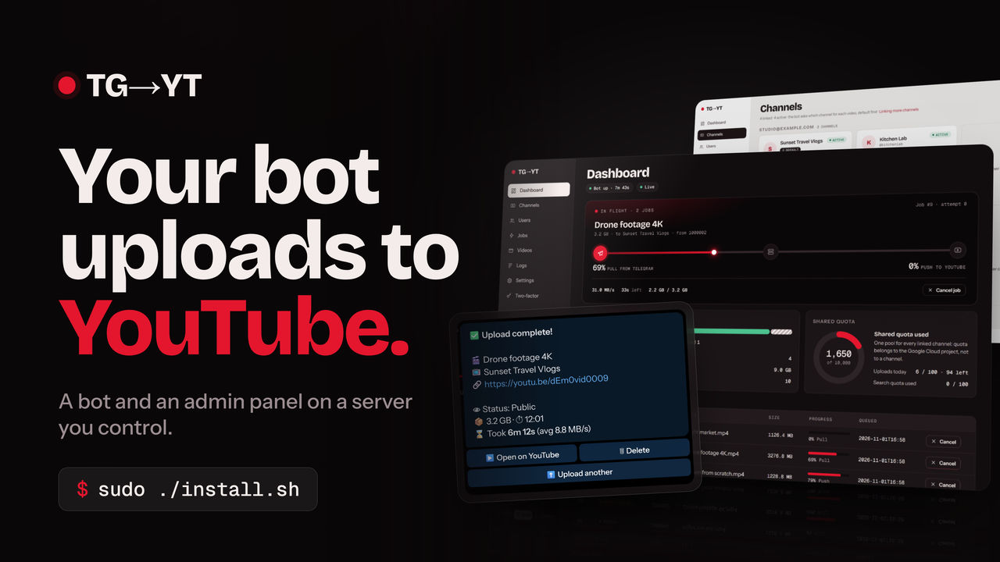
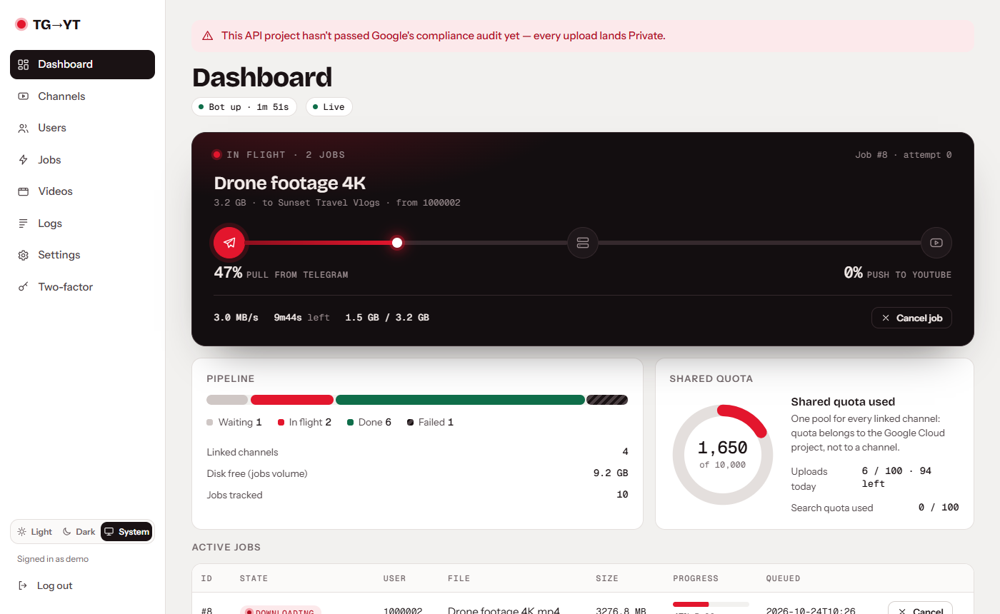
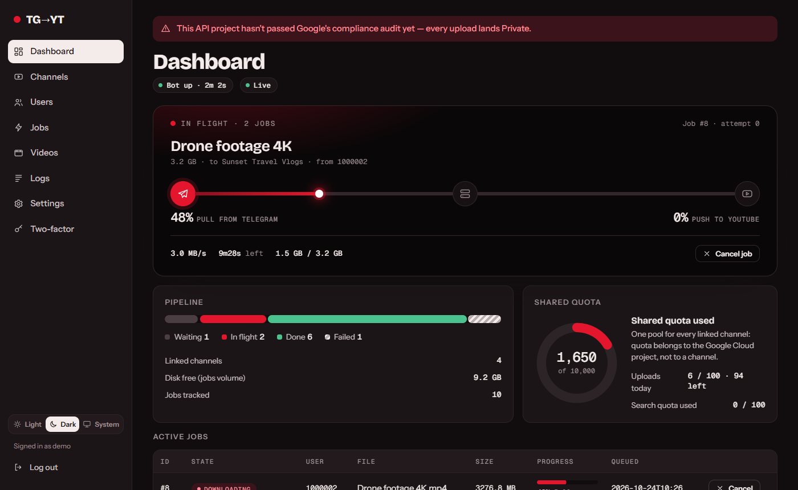
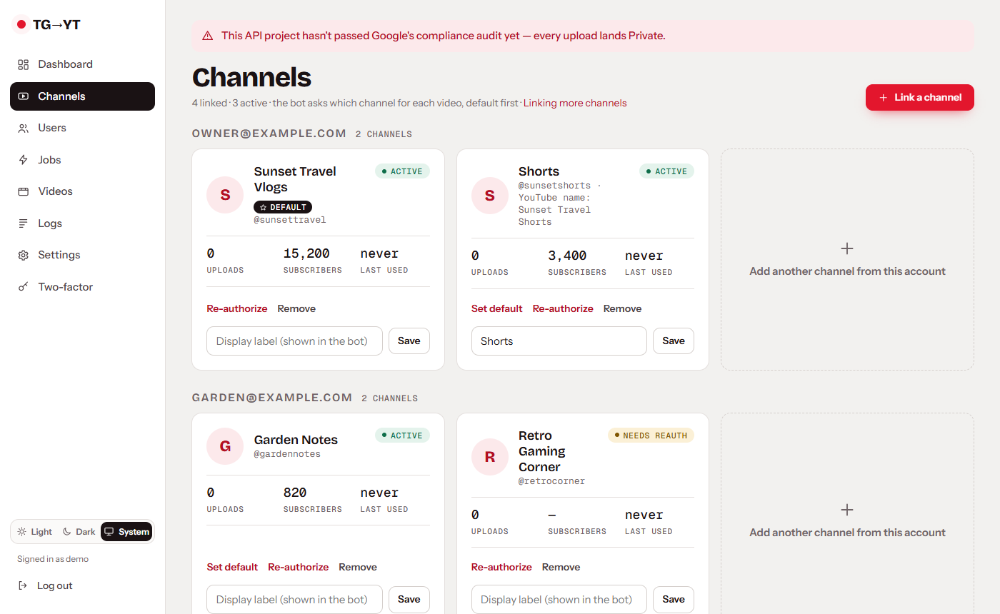
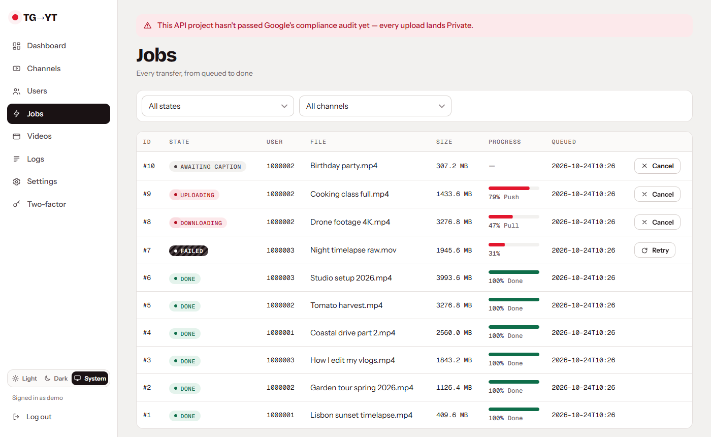
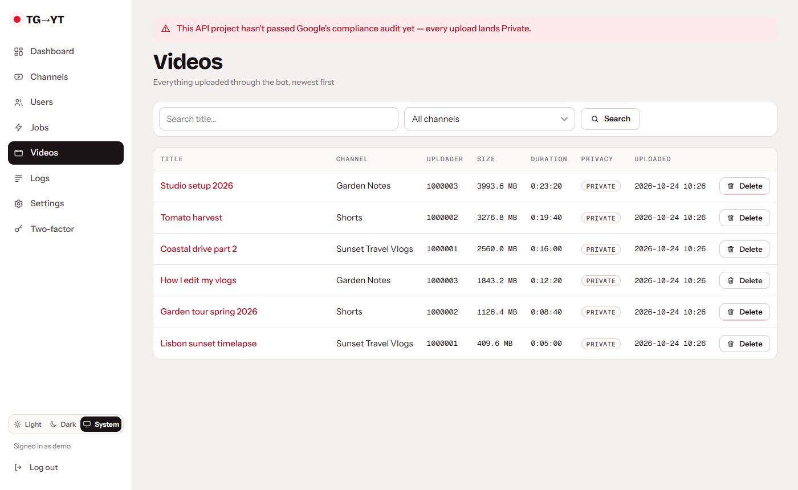
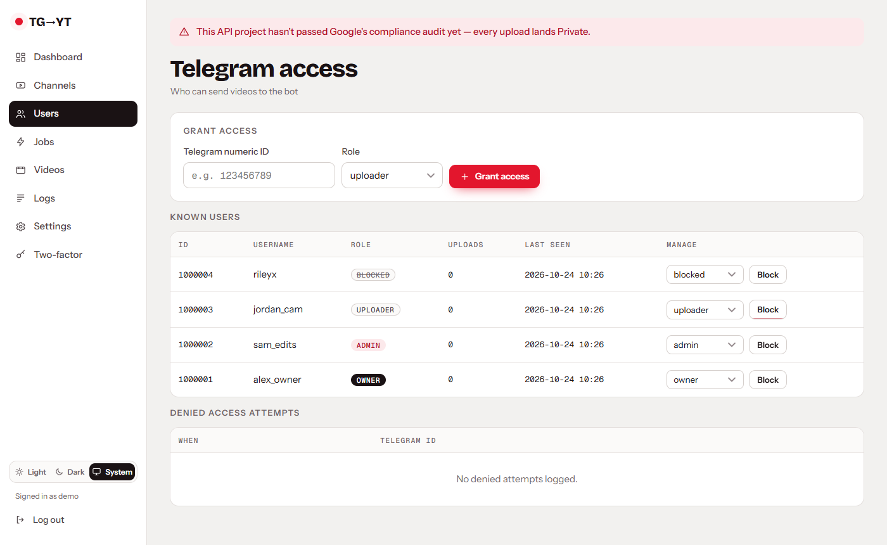
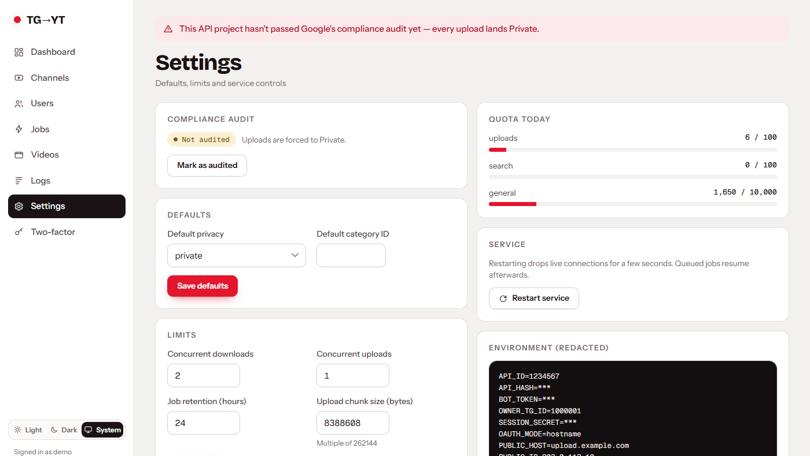
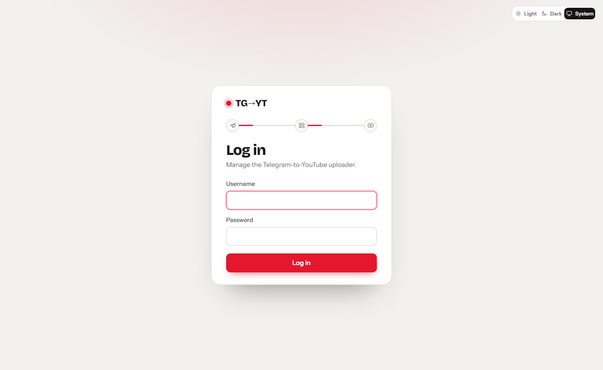
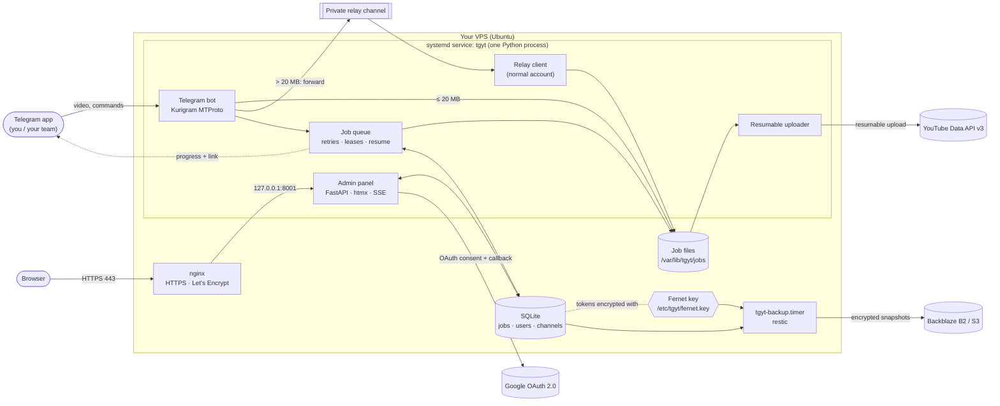

<div align="center">

# TG → YT UPLOADER V2

### Advanced Telegram-to-YouTube Video Upload Automation Platform

**Send a video to your Telegram bot. It lands on your YouTube channel.**<br>
A self-hosted bot and admin panel on a server you control, installed by one guided command.

[](CHANGELOG.md)
[](docs/12-development.md#requirements)
[](#requirements-and-compatibility)
[](docs/04-telegram-setup.md)
[](docs/05-google-cloud.md)
[](https://github.com/NimeshPiyathissa/TG-TO-YT-UPLOADER-V2/actions/workflows/ci.yml)
[](LICENSE)

[Overview](#product-overview) · [Features](#key-features) · [Screenshots](#application-screenshots) · [Architecture](#system-architecture) ·
[Quick install](#quick-installation) · [A–Z VPS guide](#az-vps-installation) · [Domains](#domain-and-subdomain-setup) ·
[Telegram](#telegram-setup) · [Google & YouTube](#google-cloud-and-youtube-oauth) · [Developers](#developer-setup) ·
[Backups](#backup-and-disaster-recovery) · [Troubleshooting](#troubleshooting) · [Security](#security-recommendations) ·
[Docs](#documentation-index)

</div>

---

## Product overview

TG → YT Uploader V2 turns a Telegram bot into an upload desk for YouTube. You (or people you allow) send a video to the bot; it downloads the
file on your server, uploads it to the YouTube channel you pick with the title you type, shows live progress, and replies with the link.

Everything runs on **one VPS you own**: a Telegram bot, a job queue, a web admin panel with two-factor login, and a `tgyt` management command.
Your YouTube logins are stored encrypted on that server and never leave it. A 13-step installer sets up the whole stack (HTTPS, firewall,
service, backups) and checks every answer as you go.

| Who it's for | What you get |
|---|---|
| Creators and teams who receive footage on Telegram | No re-downloading and re-uploading by hand; uploads keep running when your phone or PC is off |
| People managing several channels | Several Google accounts and Brand Account channels, a default channel, per-channel labels |
| Admins | Roles for Telegram users, a web panel with history and audit log, encrypted off-site backups |

> [!IMPORTANT]
> **You need your own (free) Google Cloud project.** YouTube only allows uploads through an app's own API credentials. A new project gets about
> **6 uploads per day**, and videos stay **Private** until Google audits the project. These are YouTube's rules, not limits of this software:
> [details](docs/08-limits.md).

## Key features

**Telegram bot**
- Send a video (as a video or as a file), choose the channel, type the title and optional description, and watch a live progress message.
  When it's done the bot replies with the YouTube link.
- Files up to **2 GB**, or **4 GB** when the relay account has Telegram Premium. Telegram limits bots to 20 MB downloads, so larger files go through
  a **large-file relay**: the bot forwards the video to your private relay channel, a normal Telegram account downloads it, and the relay copy is
  deleted afterwards.
- Roles: **owner › admin › uploader › blocked**. Strangers are refused and shown their numeric ID, so you can grant them access in the panel;
  someone you promote to admin gets a Telegram message.
- Commands: `/start` `/help` `/status` `/id` `/channels` `/addyt` `/removeyt` `/jobs` `/cancel`, with inline buttons for channel choice,
  cancelling, retrying or discarding a failed job, uploading another video, and deleting an uploaded video from YouTube.

**YouTube**
- **Several channels** from **several Google accounts**, including **Brand Account** channels, grouped by account. A default channel and
  display labels apply in the bot and the panel.
- **Resumable uploads**: after a restart or crash an upload continues from the last byte Google confirmed. Failed steps retry automatically with
  back-off; jobs survive restarts.
- Google tokens are stored **encrypted (Fernet)** and refreshed automatically. Broken authorizations are flagged and skipped until you
  re-authorize them.
- Daily **quota tracking** (YouTube's 10,000 units per project), privacy and category defaults, title from your message or the file name,
  and deleting an uploaded video from the bot or the panel.

**Web admin panel**
- Dashboard with **live transfer progress** (server-sent events), channels, Telegram users and roles, jobs, uploaded videos, logs and audit trail,
  settings. Light and dark mode.
- **TOTP two-factor login**, Argon2 password hashing, CSRF protection, login throttling and lock-outs, `Secure`/`SameSite=Strict` cookies, HSTS,
  and clickjacking protection.

**Operations**
- **13-step installer** with validation (live bot-token check, DNS check, password strength), Let's Encrypt HTTPS, ufw firewall, fail2ban,
  optional key-only SSH with an automatic lock-out safeguard.
- **`tgyt` command**: status, doctor (diagnoses and prints the fix), logs, config, relay setup and self-test, admin reset, backup, restore,
  update with **automatic rollback**, uninstall.
- **Backups**: nightly local archives plus **encrypted off-site copies** to Backblaze B2 or any S3-compatible storage (restic), with checksum,
  database and key verification and a **non-destructive restore test**. Failures are reported to you on Telegram.

**Not included** (so you aren't surprised): no scheduling of uploads for a later time, no custom thumbnails, no playlists, no editing of
videos already on YouTube (only deleting), no Docker image. Animated (Premium) emoji in bot messages only appear when the bot's owner has Telegram Premium
([known limitations](#known-limitations)).

## Application screenshots

Real captures of the admin panel, filled with **made-up demo data** (no real accounts, channels or IDs).

| Dashboard | Dashboard, dark mode |
|---|---|
|  |  |

| Channels (grouped by Google account) | Jobs |
|---|---|
|  |  |

| Uploaded videos | Telegram users and roles |
|---|---|
|  |  |

| Settings | Login |
|---|---|
|  |  |

The image at the top of this page is a promotional composition built from the same panel and bot designs. Screenshots of the Telegram chat,
the installer and the backup commands are not included yet; their output is shown as text in the guides.

## System architecture



One systemd service runs the bot, the relay client, the queue, the uploader and the panel in a single Python process (`Restart=always`,
sandboxed, memory-limited). nginx terminates HTTPS. The database, the encryption key and your tokens stay on the server.
More: [docs/architecture.md](docs/architecture.md).

## How the platform works

1. **Send** a video to the bot in Telegram. The bot checks your role and the file size.
2. **Choose** the channel (or the default is used) and type the title; the description is optional.
3. **Download**: small files come straight from Telegram; larger ones go through the relay. The job is saved, so a restart doesn't lose it.
4. **Upload**: the file is sent to YouTube in resumable chunks. Your progress message and the panel's dashboard update live.
5. **Done**: the bot replies with the link and the panel records the video. The local file is deleted after `JOB_RETENTION_HOURS`.

Commands, roles and everyday tasks: [docs/09-daily-use.md](docs/09-daily-use.md).

## Quick installation

On a fresh **Ubuntu 26.04 or 24.04** VPS, with a domain's A record already pointing at it:

```bash
git clone https://github.com/NimeshPiyathissa/TG-TO-YT-UPLOADER-V2.git
cd TG-TO-YT-UPLOADER-V2
sudo ./install.sh
```

<details>
<summary>One-line alternative (downloads to <code>/opt/tgyt-src</code>, then starts the same installer)</summary>

```bash
curl -fsSL https://raw.githubusercontent.com/NimeshPiyathissa/TG-TO-YT-UPLOADER-V2/main/install.sh | sudo bash
```

Both commands download anonymously, so they only work while the repository is **public**. For a private repository see
[docs/14 → If the repository is private](docs/14-releases-and-upgrades.md#if-the-repository-is-private).
</details>

Then open the panel address the installer prints, link a channel, and send `/start` to your bot.

## A–Z VPS installation

The full, beginner-friendly path. Each step links to a detailed guide.

| # | Step | Guide |
|---|---|---|
| 1 | **Get a VPS** (1 GB RAM minimum, 2 GB recommended, 25 GB disk), install Ubuntu, log in with SSH from Windows PowerShell, create an SSH key | [02 · Get a VPS](docs/02-get-a-vps.md) |
| 2 | **Point a domain or subdomain** at the VPS with an A record | [03 · Domain and DNS](docs/03-domain-and-dns.md) |
| 3 | **Telegram**: create the bot, get the API ID/hash and your user ID, prepare the relay channel | [04 · Telegram](docs/04-telegram-setup.md) |
| 4 | **Google Cloud**: project, YouTube Data API v3, consent screen, Web OAuth client with the redirect URI | [05 · Google Cloud](docs/05-google-cloud.md) |
| 5 | **Run the installer** and answer its questions | [06 · Installer](docs/06-install.md) |
| 6 | **Link channels** in the panel, including Brand Accounts | [07 · Linking channels](docs/07-linking-channels.md) |
| 7 | **Test**: `/start`, a short video, `sudo tgyt doctor` | [09 · Daily use](docs/09-daily-use.md) |
| 8 | **Back up off-site** and run a restore test | [13 · Backups](docs/13-backup-and-recovery.md) |

What the installer does, step by step:

```
[1/13] Checking your server          [8/13]  System service (systemd)
[2/13] Your settings                 [9/13]  Web server and HTTPS (nginx + Let's Encrypt)
[3/13] System packages               [10/13] Firewall and fail2ban
[4/13] Service user and folders      [11/13] Large-file relay (optional Telegram login)
[5/13] Application files             [12/13] Optional: key-only SSH (auto-reverts if you get locked out)
[6/13] Python environment            [13/13] Checking that everything works (tgyt doctor)
[7/13] Keys, configuration, admin account
```

It re-asks until each answer is valid, types secrets hidden, verifies the bot token with Telegram, checks that DNS points at the server before
requesting a certificate, and is safe to run again: it repairs the installation and never overwrites your database, key or settings without
asking. Every question is explained in [docs/06-install.md](docs/06-install.md), including unattended installs.

### Requirements and compatibility

| Item | Status |
|---|---|
| Ubuntu **26.04 LTS** (Python 3.14) | **Tested on a staging server**: install, real uploads, an update, backups and restore tests |
| Ubuntu 24.04 / 22.04 LTS | Supported by the installer's checks; **not re-tested for v1.0.1** |
| CPU | x86_64 or arm64 |
| RAM / disk | 1 GB minimum (a swap file is added), 2 GB recommended; disk ≥ largest video × 1.2 + 5 GB free |
| Ports | 22 (SSH), 80 and 443 reachable from the internet |

## Domain and subdomain setup

The panel needs a hostname with real HTTPS, because Google won't redirect back to a bare IP. A subdomain such as `upload.example.com` is ideal:

| Type | Host | Value | TTL |
|---|---|---|---|
| A | `upload` | your VPS IPv4, e.g. `203.0.113.10` | 300 or Auto |

[docs/03-domain-and-dns.md](docs/03-domain-and-dns.md) walks through **Spaceship** and **Cloudflare** (use *DNS only*), several subdomains on
one VPS, checking records with `Resolve-DnsName`, `nslookup` and `dig`, what the installer configures in nginx and Let's Encrypt, and the Google
redirect URI (`https://<your-host>/oauth/callback`). No domain? The installer can use a free `sslip.io` name.

## Telegram setup

You need a bot token from **@BotFather**, an **API ID and API hash** from my.telegram.org, and **your numeric user ID** (the owner). For videos over
20 MB, add a **relay**: a private channel where your bot is an administrator and a normal Telegram account is a member. `sudo tgyt relay` logs that
account in (phone, code, 2FA) and stores its session; `sudo tgyt relay-test` proves the path end to end.

Guide: [docs/04-telegram-setup.md](docs/04-telegram-setup.md), including token rotation and the command list for BotFather's `/setcommands`.

## Google Cloud and YouTube OAuth

1. Create a Google Cloud project and enable **YouTube Data API v3**.
2. Configure the **OAuth consent screen** (External; add yourself as a test user while in *Testing*).
3. Create an **OAuth client → Web application** with the redirect URI `https://<your-host>/oauth/callback`, and download its JSON.
4. Panel → **Channels → Link a channel** → upload the JSON, then **Link a channel** and pick the Google account and channel.

Each linked channel has its own encrypted authorization; one client JSON covers every account. **Brand Account** channels work when your Google
account is an owner or manager of the Brand Account. Access granted only through YouTube Studio's *channel permissions* is not available to the
API. While the consent screen is in *Testing*, Google expires authorizations after 7 days.

Guides: [05 · Google Cloud](docs/05-google-cloud.md) · [07 · Linking channels](docs/07-linking-channels.md) · [08 · Limits](docs/08-limits.md).

## Developer setup

```bash
git clone https://github.com/NimeshPiyathissa/TG-TO-YT-UPLOADER-V2.git && cd TG-TO-YT-UPLOADER-V2
python -m venv .venv && source .venv/bin/activate        # Windows: py -3.12 -m venv .venv; .\.venv\Scripts\Activate.ps1
pip install -r requirements-dev.txt
python -m pytest -q
```

Windows and Linux setup, running the bot and panel locally with a test bot, the source tour, the workflow and safe deployments:
[docs/12-development.md](docs/12-development.md). Contribution rules: [CONTRIBUTING.md](CONTRIBUTING.md).

## Configuration

All settings live in `/etc/tgyt/tgyt.env` (mode 600). Change them with the validated command rather than by hand:

```bash
sudo tgyt config                 # list (secrets hidden)
sudo tgyt config MAX_FILE_BYTES  # change one; asks before restarting
```

Concurrent downloads and uploads, job retention, default privacy and category can also be set in the panel's **Settings**; those values win
over the file. Every key, default and file location:
[docs/configuration.md](docs/configuration.md).

## Testing and quality assurance

- **Automated suite**: 288 tests (pytest) covering the queue and resumable uploads against a fake Google server, channel linking and Brand
  Accounts, bot handlers through the real Kurigram parser and dispatcher, the panel's live progress, the installer's validation, the `tgyt` command (backups,
  manifests, restore checks, token rotation), the panel's security headers, the documentation and the tools. For v1.0.1: 288 passed on
  Ubuntu 26.04 / Python 3.14; 286 passed + 2 skipped by design on Windows / Python 3.12.
- **CI** on every push and pull request: the tests on Python 3.12 and 3.14 (including documentation link checks), a ruff error lint,
  ShellCheck on all shell scripts, and a gitleaks secret scan ([workflow](.github/workflows/ci.yml)).
- **Real-world checks on a staging server** (Ubuntu 26.04) for v1.0.1: six real uploads through the relay (717 MB to 1.45 GB each), a
  token rotation, an update with health check, and off-site backup plus restore tests. Not yet verified on a fresh server or on Ubuntu
  24.04/22.04; see [known limitations](#known-limitations).

```bash
python -m pytest -q                          # everything (~3 min)
shellcheck -x -P deploy install.sh deploy/install.sh deploy/tgyt deploy/lib/*.sh
sudo tgyt doctor                             # on a server: checks every part of a live installation
```

## Backup and disaster recovery

The database holds your encrypted YouTube logins, and **`/etc/tgyt/fernet.key` is the only key that decrypts them**.

- **Local**: every night, last 7 kept in `/var/backups/tgyt`. `sudo tgyt backup` makes one now.
- **Off-site**: `sudo tgyt offsite setup` → encrypted restic snapshots in **Backblaze B2** (bucket-scoped key), retention 7 daily / 4 weekly /
  6 monthly, weekly data check, Telegram alert on failure. **Keep the encryption password in your password manager.**
- **Prove it works**: `sudo tgyt offsite restore-test` downloads, decrypts and verifies the newest snapshot (checksums, database integrity,
  Fernet key) in a temporary folder, without changing anything.
- **Recover**: `sudo tgyt restore FILE` or `sudo tgyt offsite restore`. On a new VPS: install, `tgyt offsite setup` with the same bucket and
  password, then `tgyt offsite restore`.

Full guide: [docs/13-backup-and-recovery.md](docs/13-backup-and-recovery.md).

## Troubleshooting

Start with **`sudo tgyt doctor`**: it checks the service, HTTPS and certificate renewal, Telegram, the relay, Google, the database, permissions,
the firewall and backups, and prints a fix for each problem.

| Symptom | Where to look |
|---|---|
| Certificate failed during install | DNS not pointing at the server, proxied Cloudflare record, or port 80 blocked → [SSL](docs/10-troubleshooting.md#ssl) |
| Videos over 20 MB rejected | relay not set up → `sudo tgyt relay`, then `sudo tgyt relay-test` |
| Uploads stay Private / only ~6 a day | YouTube's rules for unaudited projects → [limits](docs/08-limits.md) |
| A channel turns red every 7 days | consent screen in *Testing* → re-authorize or publish it ([guide](docs/07-linking-channels.md#re-authorizing-every-7-days)) |
| Bot silent after a token change | set tokens with `sudo tgyt config BOT_TOKEN` ([guide](docs/10-troubleshooting.md#relay)) |

Everything else: [docs/10-troubleshooting.md](docs/10-troubleshooting.md).

## Security recommendations

- Secrets stay on your server: `/etc/tgyt/tgyt.env` (600), the Fernet key (400), Google tokens encrypted in the database. Logs and the panel's
  settings view are redacted.
- The service runs as a no-login user inside a systemd sandbox; the panel is HTTPS-only with HSTS, Argon2, TOTP and CSRF protection.
- **Your part**: turn on two-factor login, set up off-site backups and keep their password safe, treat the relay session like a password (it
  gives full access to that Telegram account), rotate a bot token immediately if it leaks, and keep Ubuntu updated.
- Never commit or paste tokens, session strings, client secrets, keys or backups anywhere public, including chats and issue reports.

Details: [docs/11-security.md](docs/11-security.md). Reporting a vulnerability: [SECURITY.md](SECURITY.md).

## Updating and maintaining the project

```bash
sudo tgyt update                  # newest release: shows the changes, asks, upgrades, health-checks, rolls back automatically if unhealthy
sudo tgyt update --ref v1.0.1     # a specific version
sudo tgyt rollback                # back to the version (and database) from before the last update
```

Update when nothing is uploading. Routine care (certificate, disk, backups, logs) is in [docs/09-daily-use.md](docs/09-daily-use.md#routine-care);
versioning, private-repository updates and the release checklist are in [docs/14-releases-and-upgrades.md](docs/14-releases-and-upgrades.md).
To remove it: `sudo tgyt uninstall` (offers a final backup and asks before deleting any data).

## Release notes

**v1.0.1** (2026-11-02), the first public release:

- Backups: fixed the `MANIFEST.txt` self-checksum that made every restore check fail; v1.0.0 backups stay restorable.
- Bot: `/jobs` and `/cancel <id>` answered nothing (a text handler swallowed them); fixed, with tests through the real dispatcher.
- Reliability: a startup failure now ends the process so systemd restarts it; `tgyt config BOT_TOKEN` handles token rotation safely; a burst
  of messages from a new Telegram user no longer crashes handlers.
- Security: the panel refuses to be embedded in other sites (clickjacking protection).
- Documentation: developer guide, backups and disaster recovery, releases and upgrades, an extended domain and DNS guide, licence notices.

Full history: [CHANGELOG.md](CHANGELOG.md).

### Known limitations

- **Premium (animated) emoji** in bot messages show only if the bot's owner account has Telegram Premium (or the bot has a Fragment username).
  Otherwise Telegram replaces them with normal emoji; everything else works.
- **YouTube**: about 6 uploads per day per Google Cloud project, Private until Google's audit, 15-minute cap on unverified channels, 7-day
  re-authorization while the consent screen is in *Testing* ([details](docs/08-limits.md)).
- **Telegram**: 2 GB per file (4 GB with a Premium relay account); files over 20 MB need the relay.
- **Single server**: one process on one VPS; no high-availability or multi-server mode.

## Documentation index

| Getting started | Running it | Reference |
|---|---|---|
| [01 · What it does](docs/01-overview.md) | [07 · Linking channels](docs/07-linking-channels.md) | [Configuration](docs/configuration.md) |
| [02 · Get a VPS](docs/02-get-a-vps.md) | [08 · Limits](docs/08-limits.md) | [Architecture](docs/architecture.md) |
| [03 · Domain, subdomain and DNS](docs/03-domain-and-dns.md) | [09 · Day-to-day use](docs/09-daily-use.md) | [12 · Developer guide](docs/12-development.md) |
| [04 · Telegram setup](docs/04-telegram-setup.md) | [10 · Troubleshooting](docs/10-troubleshooting.md) | [14 · Releases and upgrades](docs/14-releases-and-upgrades.md) |
| [05 · Google Cloud setup](docs/05-google-cloud.md) | [11 · Security](docs/11-security.md) | [Changelog](CHANGELOG.md) |
| [06 · Running the installer](docs/06-install.md) | [13 · Backups and recovery](docs/13-backup-and-recovery.md) | [Contributing](CONTRIBUTING.md) · [Security policy](SECURITY.md) |

## License and ownership

Copyright © 2026 Nimesh Isuranga Piyathissa.

This program is free software: you can redistribute it and/or modify it under the terms of the **GNU Affero General Public License,
version 3** (only), as published by the Free Software Foundation (SPDX: `AGPL-3.0-only`). It is distributed in the hope that it will be
useful, but WITHOUT ANY WARRANTY; without even the implied warranty of MERCHANTABILITY or FITNESS FOR A PARTICULAR PURPOSE. See
[LICENSE](LICENSE) for the full text.

**In practice:** you may install, use, change and share it, including commercially. If you run a **modified** version for other people
(through the bot or the panel), you must offer them its source code under the same licence: set `SOURCE_CODE_URL` to where your version's
source is published; the panel and `/help` link to it. Bundled fonts and libraries keep their own licences
([THIRD_PARTY_NOTICES.md](THIRD_PARTY_NOTICES.md)). YouTube and Telegram are trademarks of their respective owners; this project is not
affiliated with or endorsed by Google or Telegram.

## Credits and support

Built by [Nimesh Isuranga Piyathissa](https://github.com/NimeshPiyathissa). Powered by [Kurigram](https://github.com/KurimuzonAkuma/pyrogram),
[FastAPI](https://fastapi.tiangolo.com), [htmx](https://htmx.org), the Google API Python client, [restic](https://restic.net), nginx and
Let's Encrypt.

- **Questions and bug reports**: [GitHub Issues](https://github.com/NimeshPiyathissa/TG-TO-YT-UPLOADER-V2/issues). Run `sudo tgyt doctor`
  first and include its output, with secrets removed.
- **Security problems**: don't open a public issue; follow [SECURITY.md](SECURITY.md).
