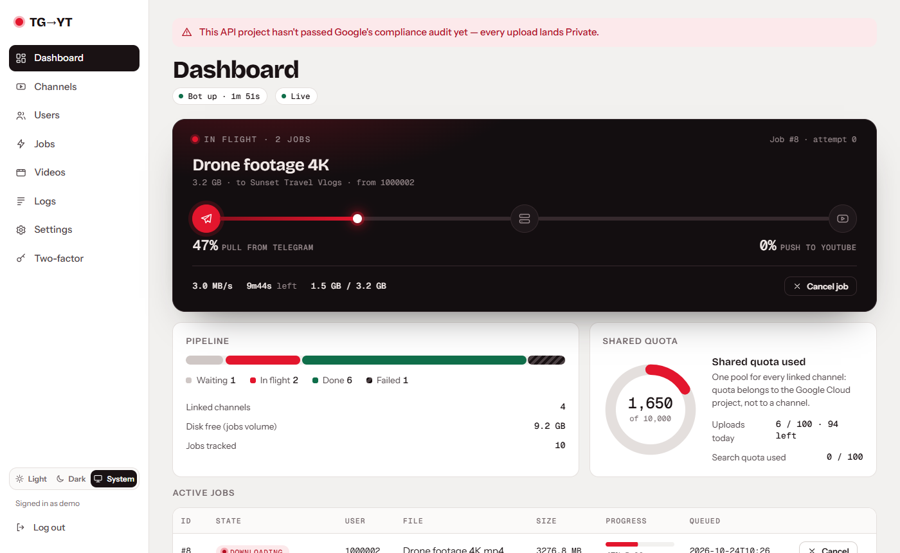
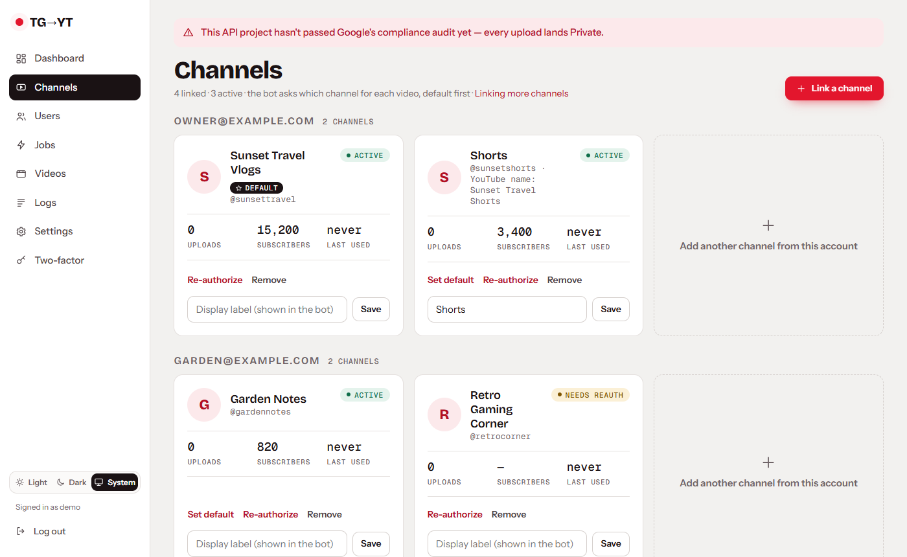
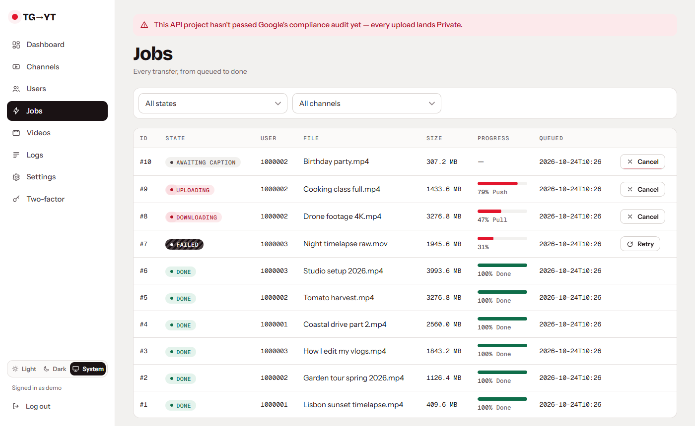
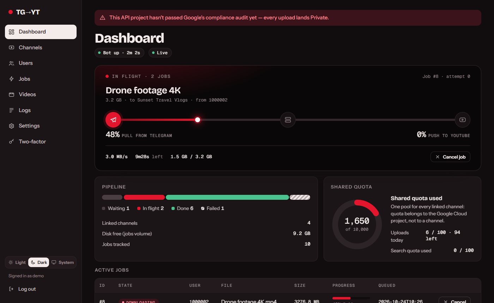
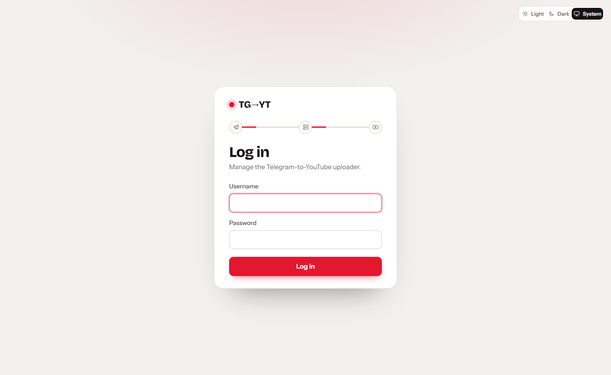
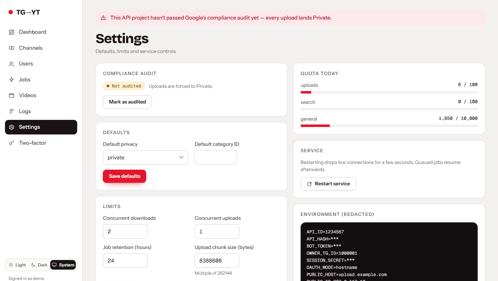

# 1. What it does

TG → YT Uploader is a Telegram bot plus a small web admin panel that run together on your own server.

```
 you ──video──▶ Telegram bot ──▶ your server (downloads it) ──▶ YouTube (resumable upload)
                     ▲                         │
                     └── progress, link ◀──────┘          admin panel: manage everything in a browser
```

## Features

**Telegram bot**
- Send a video → choose the YouTube channel → add a title/caption → upload with a live progress bar; you get the YouTube link and elapsed time.
- Files over 20 MB work through the **large-file relay** (a second, real Telegram account relays the bytes through a private channel,
  because bots can only download 20 MB). Up to **2 GB**, or **4 GB** if the relay account has Telegram Premium.
- Commands: `/start`, `/help`, `/status`, `/id`, `/channels`, `/addyt`, `/removeyt`, `/jobs`, `/cancel`.
- **Roles:** `owner` (set at install) › `admin` › `uploader` › `blocked`. Anyone else is told their numeric ID and refused. Admin/owner can
  add and remove channels. People promoted from the panel get a Telegram message.
- Premium emoji and formatted messages when available.

**YouTube**
- Multiple channels, including **Brand Accounts**, from multiple Google accounts, grouped by account in the panel, `/channels` and the picker.
  A default channel and optional display labels. If a channel's login breaks it is skipped in the picker and you are told to re-authorize.
- Resumable uploads: restart the server mid-upload and it continues from the byte Google confirmed.
- Automatic retries with back-off; a failed job can be retried or cancelled.
- Daily quota shown in the panel and the bot.

**Reliability**
- Disk checks before each download (needs the file size × 1.2 plus a 5 GB safety margin free); downloads wait for space instead of failing.
- Job files are cleaned up after 24 h (configurable); jobs left waiting for a channel/caption expire after 48 h.
- Memory-safe: files stream to disk and upload in 8 MB slices.

**Admin panel** (red theme, dark mode)

| Page | What it does |
|---|---|
| Dashboard | linked channels, quota, active jobs with **live progress (SSE)**, disk free, bot status, uptime |
| Channels | link / re-authorize / remove channels, set default and labels, grouped by Google account |
| Users | Telegram access control by numeric ID, feed of denied attempts with one-click "grant access" |
| Jobs | active and past uploads, filters, cancel / retry |
| Videos | everything uploaded; delete (also removes it from YouTube) |
| Logs | service log with filters, audit log of every privileged action, download |
| Settings | Google OAuth client, audit toggle, default privacy/category, concurrency, chunk size, retention, quota, restart, redacted env view |

Security of the panel: Argon2 password hashing, optional/required **TOTP** two-factor, per-account and per-IP lockout
(5 failures → 15 min), CSRF protection on every form, secure cookies.

## Screenshots

| Dashboard | Channels | Jobs |
|---|---|---|
|  |  |  |

| Dark mode | Login | Settings |
|---|---|---|
|  |  |  |

(Screenshots use made-up data.)

## What it is not

- It is not a hosted service. You run it, you own the data, and you need your own Google Cloud project ([why](08-limits.md)).
- It does not bypass YouTube's limits (quota, 15-minute cap for unverified channels, private-until-audited).
